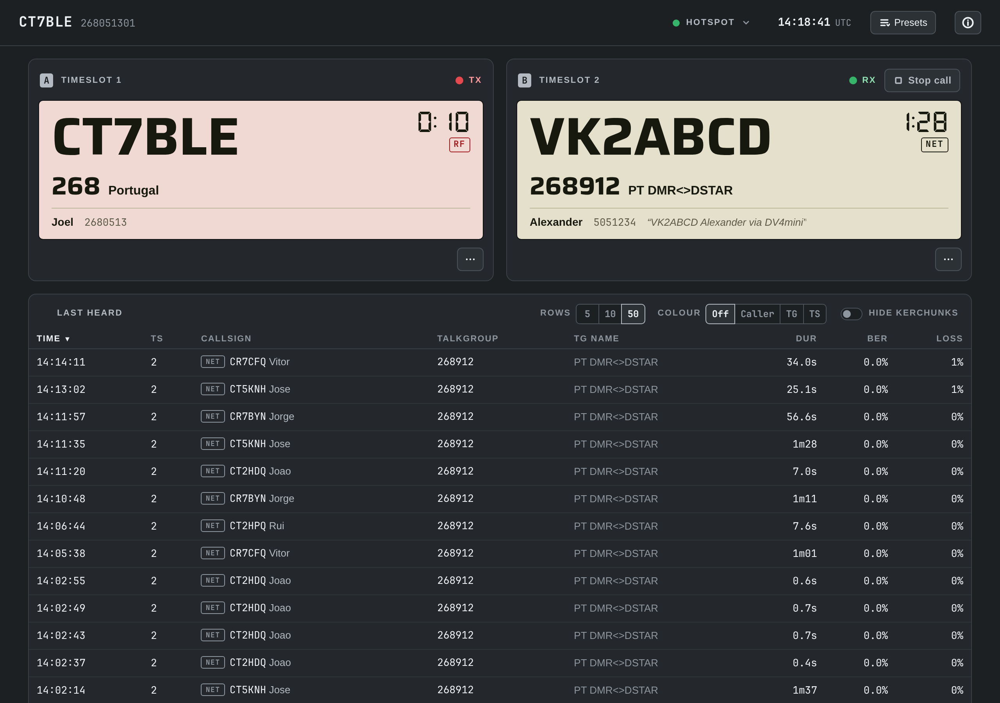
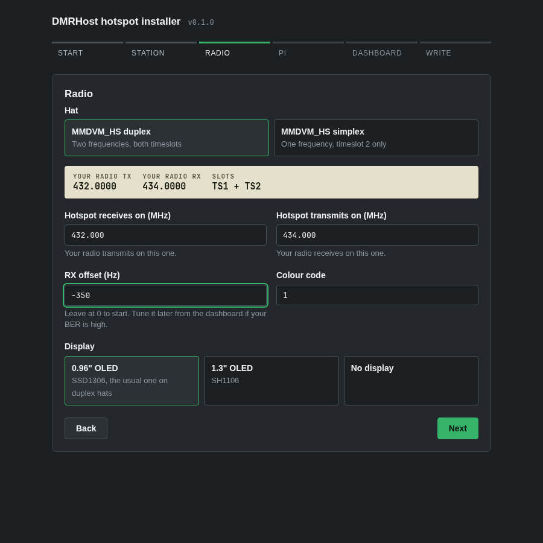

import KofiBanner from '~/components/KofiBanner.astro'

# DMRHost vs WPSD: Why I Switched, How to Install It, and a Modern Custom Dashboard

If you own an MMDVM hotspot—whether a duplex or simplex hat sitting on top of a Raspberry Pi Zero 2 W, 3, or 4—chances are you have been running Pi-Star or [WPSD](https://wpsd.radio/) (W0CHP's polished fork).

For general multi-mode digital voice, WPSD is an incredible piece of software. If you routinely bounce between DMR, D-STAR, Yaesu System Fusion (YSF), P25, NXDN, and M17, it is practically the only game in town.

**But what if you only operate DMR on BrandMeister?**

If your hotspot lives exclusively on DMR, running a complete multi-mode appliance image often feels like driving a 40-ton semi-truck to the corner store just to buy bread. You are running MMDVMHost with translation gateways you never touch, managing an appliance OS with read-only overlay filesystems, and switching back and forth between your dashboard and the BrandMeister SelfCare website just to change a static talkgroup.

There has always been an alternative: **[BrandMeister DMRHost](https://github.com/BrandMeister/DMRHost)**. Maintained by Jonathan Naylor (G4KLX) and the BrandMeister team, DMRHost is a dedicated, ultra-lean DMR daemon. 

Until now, the barrier has been usability. DMRHost had no turnkey image, no friendly setup wizard, and no modern dashboard. You were left to hunt down apt repositories, manually configure GPIO UART overlays, hand-craft `/etc/MMDVM.ini`, and look at raw terminal logs.

To fix that, I built two companion projects:

1. **[`dmrhost-installer`](https://github.com/jcalado/dmrhost-installer)**: A zero-privilege desktop wizard (and CLI) for Linux, macOS, and Windows that sets up a standard, freshly flashed Raspberry Pi OS card with zero hassle—including direct one-click migration from your existing WPSD or Pi-Star backup.
2. **[`dmrdash`](https://github.com/jcalado/dmrdash)**: A modern, ultra-lightweight LAN dashboard built specifically for DMRHost and BrandMeister, featuring dual-timeslot live monitoring, built-in SelfCare talkgroup management, talkgroup presets, and automated RF BER / RX offset tuning.

Here is an honest breakdown of how DMRHost compares to WPSD, why you might prefer it, and how to get it running in minutes.

---

## DMRHost vs WPSD: The Real Trade-offs

Before jumping in, let's be fair: WPSD is an impressive, feature-packed distribution. Whether DMRHost makes sense for you depends entirely on what you want from your hotspot.

| Feature / Area | WPSD / Pi-Star | DMRHost + dmrdash |
| :--- | :--- | :--- |
| **Supported Modes** | **Multi-mode**: DMR, D-STAR, YSF, P25, NXDN, M17, POCSAG | **DMR only** (+ POCSAG paging) |
| **Operating System** | Custom turnkey appliance distribution with read-only filesystem overlay (`rpi-ro` / `rpi-rw`) | **Standard Raspberry Pi OS Lite (64-bit)**; pure Debian systemd |
| **Resource Footprint** | Heavier: Apache/Lighttpd, PHP, multiple cross-mode gateways and background daemons | **Minimal**: ~26 MB RAM dashboard, stdlib Python, single C++ host daemon |
| **BrandMeister Talkgroups** | Handled via BrandMeister SelfCare in a separate browser tab, or DTMF / kerchunk commands | **Native API integration**: Add/drop statics, schedule nets, and switch presets right from the dashboard |
| **Timeslot Awareness** | General last-heard list; timeslot is just another table column | **Dual-VFO layout**: Live simultaneous monitoring of TS1 and TS2 with RX/TX timers and talker alias |
| **Modem Calibration** | Manual trial-and-error editing of RX/TX offsets in configuration pages | **Automated tuning**: RF BER trend plot, mathematical offset suggestion, and an interactive LCD tuning run |
| **SD Card Wear** | Mitigated by read-only rootfs overlays | **Volatile RAM logging**: Zero SD card writes during normal operation, no read-only disk gymnastics |
| **Display Support** | Extensive: Nextion screens with custom layouts, HD44780 LCD, OLED | Standard OLED (SSD1306 / SH1106) via DisplayServer + web/terminal dash |

### The Advantages of DMRHost + dmrdash

#### 1. A Clean, Standard Linux System
With WPSD, your Pi is treated as an appliance. Making standard Debian administrative tweaks, running custom scripts, or handling package updates means dealing with read-only filesystem modes (`rpi-rw`) and custom update wrappers.

With `dmrhost-installer`, you start from an official, untampered **Raspberry Pi OS Lite (64-bit)** card. Everything runs as standard `systemd` services (`dmrhost.service`, `dmrdash.service`, `displayserver.service`). Routine maintenance is just `sudo apt update && sudo apt upgrade`. If you want to use the Pi for other lightweight background tasks, it's just a normal Linux machine.

#### 2. Native BrandMeister Talkgroup Management
If you've used WPSD or Pi-Star, you know the drill: you want to join a regional net or talk on a specific talkgroup, so you open your browser, log in to `brandmeister.network`, navigate to SelfCare, find your hotspot ID, enter your password or API key, add the static talkgroup, wait for it to apply, and remember to remove it when you're done.

`dmrdash` connects directly to the BrandMeister v2 API using your SelfCare API key. Right from your phone or desktop:
- Add and remove static talkgroups on either timeslot in seconds.
- Drop dynamic talkgroup subscriptions or drop an active call route with one tap.
- **Scheduled Talkgroups**: Automatically add a talkgroup for a weekly club net (e.g. Thursdays 19:00–20:00 local time) with automatic day/time handling and single-tap undo.
- **Talkgroup Presets**: Save states like *"Everyday"*, *"Net Night"*, or *"Worldwide"* and toggle between them in a single tap. The dashboard computes the diff and updates BrandMeister accordingly.



#### 3. Dual-VFO Live Monitoring
On a duplex MMDVM hat, both timeslots are active simultaneously. Standard dashboards show a combined, flat "Last Heard" table where calls on TS1 and TS2 intermingle.

`dmrdash` treats your duplex hotspot like a dual-VFO radio. The top cards show both timeslots live:
- Current caller callsign, talkgroup name, country, and registered user name.
- Real-time talker alias.
- Active RX/TX duration counter with instantaneous visual feedback.
- Clear indicators for whether the transmission originated from RF (your radio) or the Network (BrandMeister).

![[phone] dmrdash phone layout](./dmrdash-phone.png "dmrdash phone layout: live dual-timeslot monitoring in your pocket.")

#### 4. Automated BER Tracking and RX Offset Tuning
Every MMDVM hat has a local oscillator (TCXO), and almost all of them suffer from slight frequency drift—especially as ambient temperatures shift. A poorly tuned RX offset causes high Bit Error Rates (BER), robotic audio, or lost transmissions.

Normally, tuning this requires either an SDR spectrum analyzer, guessing offsets in an INI file, or squinting at log lines. `dmrdash` automates the entire process:
- Tracks the BER of every incoming RF over from your radio and plots it on an inline SVG chart.
- Calculates a rolling median and warns you when BER exceeds 2%.
- Computes a parabolic fit of your recent overs across different offsets and suggests the mathematically optimal offset.
- Includes an **interactive tuning run**: the dashboard enters an LCD test mode, prompts you to key up 3 times, adjusts the offset, steps towards the lowest BER, and updates `MMDVM.ini` automatically once you confirm.

---

### Where WPSD Still Wins (The Honest Trade-Offs)

DMRHost is not for everyone. You should stick with WPSD if:
- **You need multi-mode**: If you switch between D-STAR, Yaesu System Fusion (C4FM), P25, NXDN, or M17, or use cross-mode bridging (e.g. DMR to YSF), DMRHost cannot do this. It is strictly DMR.
- **Your primary network is TGIF or FreeDMR**: While DMRHost can connect to other MMDVM/Homebrew networks, `dmrdash` is purposefully optimized for BrandMeister's API and architecture.
- **You use a Nextion screen**: If you built a custom enclosure with an elaborate Nextion LCD screen, WPSD's driver ecosystem and community layout support remain unmatched. DMRHost drives standard 0.96" (SSD1306) and 1.3" (SH1106) OLED displays via DisplayServer, while relying on `dmrdash` for your browser and mobile display.

---

## The Secret Sauce: `dmrhost-installer`

The biggest hurdle with DMRHost was always setup friction. Setting up `config.txt` UART overlays, disabling the Linux serial console, installing dependencies, configuring DisplayServer, and writing `MMDVM.ini` by hand was too tedious for most hams.

[`dmrhost-installer`](https://github.com/jcalado/dmrhost-installer) turns this into a 2-minute task.



### How It Works Under the Hood
Most hotspot installers demand raw disk writing privileges (`dd`, admin rights, custom raw disk images). `dmrhost-installer` takes a far cleaner approach:

1. You flash official, clean **Raspberry Pi OS Lite (64-bit)** using Raspberry Pi Imager.
2. The installer runs on your computer (Linux, macOS, or Windows) and **only writes configuration files to the FAT `bootfs` partition** that your OS mounts automatically. It needs no root or administrator privileges.
3. It sets up `cloud-init` configuration (`user-data`, `network-config`), kernel parameters (`cmdline.txt`), hardware overlays (`config.txt` for UART and I2C), and pre-stages the configuration files in `dmrhost-setup/`.
4. When the Pi boots for the first time, `cloud-init` executes the unattended staging script:
   - Adds the DMRHost repository and installs `dmrhost`.
   - Configures `MMDVM.ini` with your frequencies, callsign, and BrandMeister credentials.
   - Installs DisplayServer if you enabled an OLED.
   - Schedules a weekly trimmed download of the `radioid.net` user database to conserve RAM.
   - Installs and activates `dmrdash`.
   - Cleans up all sensitive setup files from disk.

### Instant WPSD / Pi-Star Migration
If you are already running WPSD or Pi-Star, you don't even have to re-type your settings. 

In your current WPSD/Pi-Star dashboard, go to **Configuration → Backup/Restore** and download your configuration `.zip`. On the first screen of `dmrhost-installer`, simply click **Import WPSD / Pi-Star Backup** (or run `wizard.py --cli --import WPSD_Config.zip`). 

The installer automatically parses your callsign, DMR ID, RX/TX frequencies, frequency offsets, BrandMeister master server, hotspot security password, Wi-Fi credentials, and hostname.

---

## Step-by-Step: Installing DMRHost and dmrdash

Here is how to set up your hotspot from scratch:

### Step 1: Flash Raspberry Pi OS Lite
1. Download and open [Raspberry Pi Imager](https://www.raspberrypi.com/software/).
2. Select your device (e.g. **Raspberry Pi Zero 2 W**, **Pi 3**, or **Pi 4**).
3. Under Operating System, select **Raspberry Pi OS (other)** → **Raspberry Pi OS Lite (64-bit)**. *(Note: 64-bit is required; trixie or bookworm).*
4. Select your SD card (8 GB or larger).
5. When prompted to apply OS customisation settings, choose **Skip customisation** (the installer handles hostnames, users, and Wi-Fi cleanly through cloud-init).
6. Click **Write**. Once done, unplug the SD card and plug it back into your computer so its `bootfs` partition mounts.

### Step 2: Run `dmrhost-installer`
Download the single standalone executable for your operating system from the [Releases page](https://github.com/jcalado/dmrhost-installer/releases/latest):

- **Linux**: `chmod +x dmrhost-installer-linux-x64 && ./dmrhost-installer-linux-x64`
- **macOS**: Clear quarantine and run:
  ```sh
  xattr -d com.apple.quarantine dmrhost-installer-macos-arm64
  chmod +x dmrhost-installer-macos-arm64
  ./dmrhost-installer-macos-arm64
  ```
- **Windows**: Run `dmrhost-installer-windows-x64.exe`.

*(You can also run it in headless terminal mode by passing `--cli`)*.

The wizard opens in your default browser:
1. **Import or Start**: Drop your WPSD backup zip, or start fresh.
2. **Identity**: Enter your callsign. The wizard automatically queries `radioid.net` to populate your DMR ID and finds your local BrandMeister master.
3. **Radio & Hat**: Select whether your hat is simplex or duplex, enter your operating frequencies, and choose your OLED display type (SSD1306, SH1106, or None).
4. **Network & System**: Enter your Wi-Fi SSID, password, Wi-Fi country code, hostname, and an SSH user/key.
5. **Dashboard & BrandMeister**: Enter your BrandMeister Hotspot Security Password (set in BrandMeister SelfCare) and your SelfCare API key for Talkgroup management.
6. **Write**: Select your mounted SD card's `bootfs` volume and click **Write to SD Card**.

### Step 3: First Boot
1. Eject the card from your computer, insert it into the Raspberry Pi with the MMDVM hat attached, and connect power.
2. Ensure the Pi has internet access (via Wi-Fi or Ethernet).
3. On first boot, the Pi runs the unattended provisioning script. This typically takes 5 to 10 minutes depending on your internet connection speed.
4. Once setup is complete, the OLED display will illuminate showing your callsign and frequencies, DMRHost will connect to BrandMeister, and the hotspot will be on the air.

### Step 4: Open dmrdash
Open your browser on your phone, tablet, or PC and navigate to:

```text
http://<your-hostname>.local:8080
```

You are greeted by the live dashboard. Both timeslots are active, talkgroups can be managed instantly, and your hotspot is ready for QSOs.

---

## Daily Operating with dmrdash

Once up and running, living with `dmrdash` feels noticeably different from traditional hotspot dashboards:

- **Quick Talkgroup Changes**: Tap **Edit Talkgroups** on either timeslot to add or drop static talkgroups on BrandMeister without ever leaving the page.
- **No Accidental Stomping**: The live dual-slot display shows active overs with millisecond accuracy, so you can see if Timeslot 2 is busy with international traffic before keying your local repeater bridge on Timeslot 1.
- **Built-in Safe Config Editor**: Need to change modem parameters or DMR IDs? The **Hotspot menu → DMRHost → Config** opens a full `MMDVM.ini` editor with validation, diff previews, and automatic rollback if DMRHost fails to start with the new configuration.
- **RF Power & Master Control**: Adjust your hotspot's RF output (10%, 25%, 50%, 100%) or switch BrandMeister master servers directly from the status popover.
- **In-Browser Terminal**: If enabled, the dashboard provides a secure in-browser terminal session or lets you launch SSH with a single click.

---

## Summary

If your digital radio operating revolves around DMR and BrandMeister, you no longer need to accept the overhead and friction of generic multi-mode appliance images.

By pairing **BrandMeister DMRHost** with **`dmrhost-installer`** and **`dmrdash`**, you get:
- A clean, standard 64-bit Raspberry Pi OS installation.
- Effortless zero-privilege setup with automated WPSD/Pi-Star configuration migration.
- A modern dual-timeslot live dashboard with native SelfCare Talkgroup control.
- Automatic RF BER monitoring and guided RX offset calibration.
- Zero unnecessary SD card writes.

Both projects are open source under the MIT licence. Give them a spin, and let me know how they work for your shack!

- **Installer**: [github.com/jcalado/dmrhost-installer](https://github.com/jcalado/dmrhost-installer)
- **Dashboard**: [github.com/jcalado/dmrdash](https://github.com/jcalado/dmrdash)
- **BrandMeister DMRHost**: [github.com/BrandMeister/DMRHost](https://github.com/BrandMeister/DMRHost)

**73 de CT7BLE,**<br />
Joel Calado

<KofiBanner showIcon message="If dmrdash or the installer made your hotspot experience better, you can buy me a coffee." />
